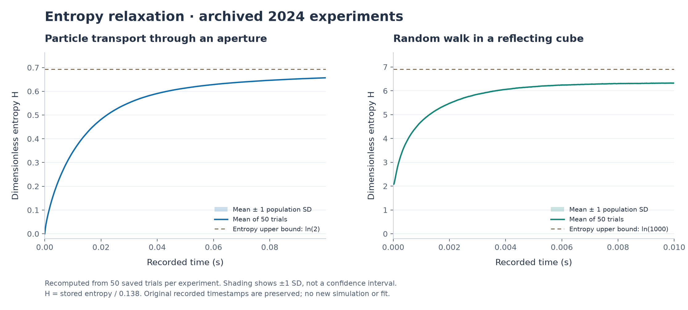

# Simulating Entropy Evolution

Summer 2024 computational physics research at Franklin & Marshall College. The research poster is coauthored by **Junyu Hu and Calvin Stubbins**. This repository brings together selected original simulation code, saved results, and the poster, with a new analysis script for exploring the archived data.



## Research question

How does coarse-grained entropy evolve as particles spread from an initially confined region toward equilibrium? The project explored two models:

| Model | Approach | Analysis |
|---|---|---|
| Ideal gas | Particle motion through a partition opening, with Maxwell-Boltzmann initial velocities | Left/right compartment occupancy and entropy over time |
| Random walk | Particle motion with randomly selected directions | Spatial cell occupancy and entropy over time |

The [original research poster](docs/Simulating_Entropy_Evolution_2024.pdf) compares simulated entropy curves with a second-order entropy-rate model. It credits both authors and includes the methods, historical results, and references.

## Three-minute review

1. **See the results:** inspect the figure above and read the poster's results and conclusions.
2. **Review the analysis:** open [analyze.py](analyze.py) to see how the archived trials are loaded, checked, summarized, and plotted.
3. **Explore the original work:** browse the [ideal-gas code](archive/2024/IG3/) and [random-walk code](archive/2024/RW1/), then read [provenance and limitations](docs/PROVENANCE.md).

## Run the archived-data analysis

```bash
python -m venv .venv
source .venv/bin/activate
python -m pip install -r requirements.txt
python analyze.py
```

On Windows PowerShell, replace the activation command with `.venv\Scripts\Activate.ps1`.

Verified with Python 3.12, NumPy 2.5.3, pandas 3.0.1, openpyxl 3.1.5, and Matplotlib 3.11.2.

The script reads [data/ideal_gas.xlsx](data/ideal_gas.xlsx) and [data/random_walk.xlsx](data/random_walk.xlsx), recomputes the mean and population standard deviation across **50 trials per model**, and checks them against the saved aggregate values. It writes:

- `figures/entropy_summary.png`: a comparison of the two archived datasets.
- `results/summary.json`: a machine-readable summary of the analysis.

The plotted quantity is dimensionless entropy, `H = S_scaled / 0.138`. Shading shows **mean ± one standard deviation across trials**, not a confidence interval. Recorded time labels are preserved; their interpretation is explained in [PROVENANCE.md](docs/PROVENANCE.md).

This script was added during portfolio preparation in **October 2026**. It analyzes saved results; it does not rerun particle dynamics, perform new curve fitting, or reproduce the poster figures exactly. The original 2024 scripts are preserved separately and require additional dependencies, including SciPy and tqdm.

## What this project demonstrates

- **Scientific computing:** translating particle-motion models into numerical simulations.
- **Statistical analysis:** comparing repeated trials, summarizing variability, and fitting model curves in the original research.
- **Data validation and visualization:** checking archived aggregates and producing a reproducible comparison from saved data.
- **Research communication:** connecting assumptions, mathematical models, numerical results, and limitations in a coauthored poster.

See [PROVENANCE.md](docs/PROVENANCE.md) for file origins, scaled units, model limitations, and the distinction between the 2024 archive and the new analysis.
